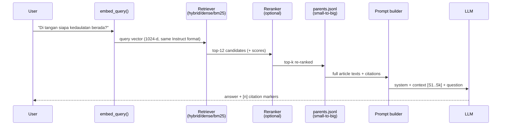

# Strategy 01 — Fixed Query Pipeline (retrieve → inject → generate)

> Entry points: `rag-vanilla/answer.py::jawab` · `rag-langchain/rag_chain.py` ·
> `webapp/backend/engine.py::run_fixed` (same bridge, different glue)

## Strategy

One deterministic path, one LLM call, zero surprises. The pipeline never asks
the LLM *how* to search — it always searches the same way, then forces the
answer to come **only** from the retrieved regulation text.



## Stage by stage (real code, real defaults)

| # | Step | Code | Defaults |
|---|---|---|---|
| 1 | Embed query | `embedder.py::embed_query` | same model + Instruct template as corpus (iron rule) |
| 2 | Retrieve | `retriever.py::retrieve` → `ExactRetriever` / `HybridRetriever` / `milvus_search` | `retrieval: hybrid` in webapp |
| 3 | Pool for rerank | pool ≥ `RERANK_POOL_SIZE` | 12 candidates |
| 4 | Rerank (optional) | `reranker.py::rerank_kandidat` | ON by default, safe cosine fallback |
| 5 | Join parent (small-to-big) | `dataset.py::context_for_parent` | dedup per `parent_id` |
| 6 | Build prompt | `prompt.py::build_context_block` + `build_messages` | 12,000-char budget |
| 7 | LLM | `llm_client.py::chat_with_usage` | OpenAI-compatible endpoint, temp 0.2 |
| 8 | Cite | `_citations_dari_kandidat` (webapp) | `[n]` chips numbered per session |

## Prompt anatomy (`prompt.py`)

```
SYSTEM  : "work ONLY from the given context; cite the articles; if the
           answer is absent from the context, say you don't know"
CONTEXT : [S1] (score 0.48) UUD — Bab I Pasal 1 Ayat (2)
          (2) Kedaulatan adalah di tangan rakyat…
          [S2] (score 0.41) UU …
STYLE   : gaya = ringkas (max 3 sentences) | standar | rinci
USER    : <question>
```

- Every context block is a numbered source `[S1]…[S8]` with its rerank score
- Truncation is **hard-capped** at 12,000 chars — long parents come in as
  Stage-03 windows instead of being clipped mid-sentence
- Only `part == "norma"` candidates can enter (guardrail by construction:
  the index contains norma only)

## Streaming variant (webapp SSE)

`webapp/backend/streaming.py::run_fixed_stream` emits the *same* pipeline as
events so the UI can render progress live:

```
status → embed_query → retrieve_dense → retrieve_bm25 → fuse_rrf
      → rerank → build_prompt → token…token → usage → done
```

Each stage also appends to the **trace** (the graph panel `n27, n28, …`),
so the answer is never a black box — you can replay which candidates were
seen and why a citation was chosen.

## Real evidence — why hybrid before rerank

Sovereignty question: cosine alone ranks Article 1 **>10** (missed);
BM25 scores it **31.3** on the exact words *"kedaulatan"* and RRF lifts it
to **#1** — then the reranker confirms it as top-1 with `score_rerank ≈ P(yes)`.
Numbers come from a live `--dry-run --show-context` run over 63,231 vectors.

Next: [02 — Retrieval strategies](02-retrieval-strategies.md)
