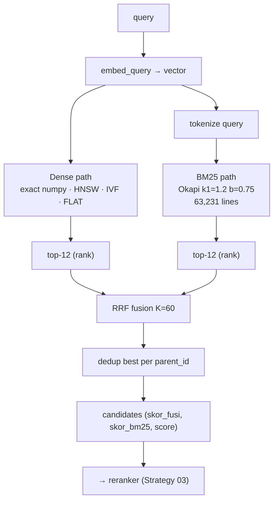

# Strategy 02 — Retrieval (dense · BM25 · hybrid RRF)

> Code: `rag-vanilla/retriever.py` (+ `bm25.py`) · `webapp/backend/engine.py`
> (`_dense_cari`, `_hybrid_cari`, `retrieval="dense"|"bm25"|"hybrid"`)

## Strategy — two orthogonal senses, fused by rank

| Path | Signal | Strong on | Weak on |
|---|---|---|---|
| **Dense** (cosine over `embeddings.npy`) | meaning | synonyms, paraphrase, mixed ID/EN | exact identifiers |
| **Lexical** (BM25 over tokens+citation+title) | words | *pasal numbers, years, doc types, technical terms* | paraphrase |

Adding their raw scores is wrong (cosine ∈ [0,1] vs BM25 ∈ [0,~20] —
incommensurable scales). The fusion is **RRF (Reciprocal Rank Fusion)**,
which only trusts *ranks*:

```
score_fusi(c) = Σ_paths  1 / (60 + rank_path(c))       (RRF_K = 60)
```



## Dense sub-strategies (pick at query time, data never moves)

| `dense_method` | Engine | Params | When |
|---|---|---|---|
| `exact` *(default)* | NumPy `matrix @ q` (mmap) | — | ground truth, <50 ms at 63k |
| `hnsw` | Milvus | search `ef` (default 64) | production ANN |
| `ivf` | Milvus | `nprobe` | only at millions of vectors |
| `flat` | Milvus | — | exact inside the server |

Webapp exposes these live (`dense_method`, `dense_ef`, `dense_nprobe` in the
request body / Graf panel) — the same collection, different search params.

## Lexical index

- Built once: `python bm25.py --build` → `pipeline/result/lexical/norma_tokens.txt`
- **63,231 lines, strictly aligned with `ids.jsonl`** (line *i* ⇄ vector *i*)
- Documents = article tokens + citation + title (identifiers survive)
- Missing index → **safe dense-only fallback** (never a crash)

## Filters & dedup

- `doc_type` (`UUD`, `UU`, `PP`, `PERPRES`, `PERMEN`, `PERLEMBAGA`, …) and
  `year` filter from `ids.jsonl` metadata — no need to open `chunks.jsonl`
- `unique_parent=True`: several ayat of the same article compete once —
  only the best-scoring verse survives before the small-to-big join, so the
  prompt never receives the same pasal three times

## Auditable scores on every candidate

| Field | Meaning |
|---|---|
| `score` | cosine (dense path; 0.0 if lexical-only) |
| `skor_bm25` | raw BM25 |
| `skor_fusi` | RRF fusion score |
| `score_rerank` | cross-encoder P(yes), after Strategy 03 |

The UI (Graf panel + citation cards) shows these numbers — a reviewer can
always ask *"why was this pasal cited?"* and get a numeric answer.

Next: [03 — Rerank strategy](03-rerank-strategy.md)
