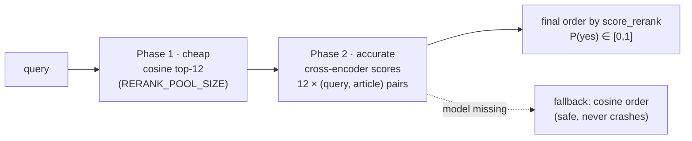

# Strategy 03 — Rerank (2-phase cross-encoder)

> Code: `rag-vanilla/reranker.py` · `rag-langchain/reranker.py` ·
> engine calls via `rerank_kandidat()` · Model: `Qwen/Qwen3-Reranker-0.6B`

## Strategy — bi-encoder finds, cross-encoder decides

A bi-encoder (the embedding model) scores query and document **separately**
— fast, but it can only compare compressed meanings. A **cross-encoder**
reads the query and the article **together, token by token**, and outputs
`P(relevant)`. Far more accurate, far too slow to run over 63,231 chunks.

So: two phases.

| Phase | Engine | Cost | Candidates |
|---|---|---|---|
| 1 | cosine (dense) or RRF (hybrid) | one matmul | `max(top_k, 12)` |
| 2 | `Qwen3-Reranker-0.6B` forward | 12 pairs, batch 4, ≤1,024 tokens each | final top-k |

## Real defaults (from `config.py`)

| Constant | Value |
|---|---|
| `RERANK` | ON (`RERANK=1`, `--no-rerank` to disable) |
| `RERANK_MODEL` | `Qwen/Qwen3-Reranker-0.6B` (loads offline from HF cache) |
| `RERANK_POOL_SIZE` | 12 |
| `RERANK_BATCH_SIZE` | 4 (CPU-friendly) |
| `RERANK_MAX_LENGTH` | 1,024 tokens per pair |

## Output contract

- `score_rerank` kept **separate** from `score` (cosine) — the UI can show
  both; nothing is overwritten
- Hover cards / citation list in the webapp display the rerank P(yes) as
  "relevansi"
- Failure to load the model (no cache, no GPU budget) → silent, logged
  fallback to cosine order — retrieval still works, only ranking quality drops

## When to turn it off

- Interactive latency on weak CPUs (`--no-rerank`)
- A/B measurement of pure hybrid RRF (compare `score_rerank` vs `skor_fusi`)
- The agent's `search_norma` tool also accepts `rerank: false` per call

Next: [04 — Agent & tool calling](04-agent-tool-calling.md)
