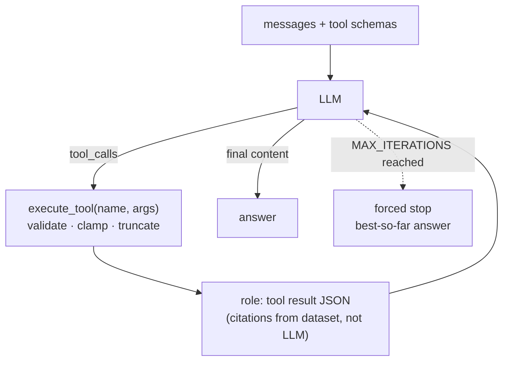

# Strategy 04 — Agent & Tool Calling

> Code: `rag-vanilla/tools.py` + `agent.py` · `rag-langchain/tools_lc.py` +
> `agent_graph.py` · `webapp/backend/engine.py::run_agent` /
> `streaming.py::run_agent_stream`

## Strategy — the LLM proposes, the code disposes

The model **never touches the database**. It only emits a *request*
(function name + JSON arguments); our dispatcher validates and executes it,
returns JSON, and the loop continues until the model answers or the iteration
cap is hit.



## The 4 tools (narrow by design)

| Tool | Purpose | Guards |
|---|---|---|
| `search_norma` | question → hybrid/dense search → rerank → full-article candidates | `top_k` **clamped 1–10** (LLM may ask 999); `doc_type` enum; `hybrid`/`rerank` booleans |
| `get_article` | `parent_id` → whole article text (small-to-big expand) | id must exist |
| `get_document` | `document_id` → official title, type, year, `legal_force_axis` | id must exist |
| `check_validity` | `document_id` → `validity.jsonl` status | **never guesses** — `pending_enrichment` is reported as-is |

Schemas are manual OpenAI-style JSON in vanilla (`TOOLS` list, understood by
Qwen3/Ollama too) and `@tool` decorators with auto type-hint schemas in the
LangChain mirror.

## Dispatcher safety (`tools.py::execute_tool`)

1. Unknown function name → error JSON, not a crash
2. Arguments parsed **defensively** (`json.loads` with fallback) — LLM JSON
   can be malformed
3. Numeric clamps (`top_k` 1–10) and 600-char text truncation on tool output
4. Results always JSON-string with dataset citations (`citation_str`,
   `official_title`, provenance) — **the LLM cannot invent a source number**,
   it can only restate what the tool returned

## Iteration caps (mandatory)

| Stack | Constant | Cap |
|---|---|---|
| `rag-vanilla/agent.py` | `MAX_ITERATIONS` | 5 |
| `rag-langchain/agent_graph.py` | `MAX_PUTARAN` | 6 (`GraphRecursionError` safety) |
| webapp `run_agent` | trace-driven | same cap + live graph nodes |

## When to use agent vs fixed pipeline

| Question shape | Architecture | Why |
|---|---|---|
| *"Who holds sovereignty…?"* | fixed | one search answers it |
| *"Is the Job Creation Law still valid?"* | agent | needs `check_validity`, not retrieval |
| *"UU 7/2017 status and its article on licensing"* | agent | multi-hop: document → article → validity |

Try the loop with zero API key (`MockLLM` replays a scripted tool sequence —
deterministic tests of the machinery, no network):

```powershell
cd rag-vanilla
..\.venv\Scripts\python.exe agent.py -q "who holds sovereignty" --dry-run
```

Next: [05 — Validity & safety](05-validity-safety.md)
