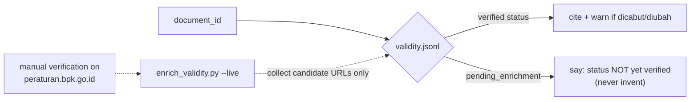

# Strategy 05 — Validity, Honesty & Safety Guardrails

> Code: `tools.py::_check_validity` · `pipeline/enrich_validity.py` ·
> system prompt in `prompt.py` · key redaction in `webapp/backend/app.py`

## Strategy — three things a legal RAG must never do

1. **Cite a repealed norm as if it were in force** → validity layer
2. **Invent an article that is not in the corpus** → honesty rules
3. **Leak secrets** → key redaction & BYO-key storage policy

## 1. Validity layer — status is evidence, not a guess

`validity.jsonl` (378 rows, default `pending_enrichment`) is joined by
`document_id` — deliberately **separate from the norm text** so statuses can
be corrected without rebuilding the index.

- `--live` mode only *harvests candidate URLs* for human review — the script
  never writes a status it cannot evidence
- The `check_validity` tool description tells the LLM, verbatim:
  *"JANGAN menebak status hukum"* — and returns `pending_enrichment` as-is

## 2. Honesty rules baked into the prompt

The system prompt (`prompt.py::SYSTEM_PROMPT`) enforces:

- Answer **only** from the injected context `[S1]…[S8]`
- Cite the articles used — sources are listed separately from the prose
- If the answer is absent from the context: **say you don't know**

Corpus boundary is real and tested — `docs/examples/sample-questions.txt` q4
asks about *PP 13/2009*, which is **not** among the 378 regulations. Correct
behavior: *"No basis found in corpus."* Operational check: if every candidate
score is < 0.2 and off-topic, the question is probably outside the corpus —
see the runbook troubleshooting table.

## 3. Secret & output safety

| Risk | Countermeasure (in code today) |
|---|---|
| API key in logs | never logged; usage counters only |
| API key in error messages | redacted before HTTP 502 (`app.py`: key string replaced with `***`) |
| API key in history | history records are built with `_sanitize_llm()` — key stripped |
| Key at rest in browser | BYO-key model: key lives in the user's `localStorage`, is sent per request, never persisted server-side |
| LLM hallucinating a source | citations are assembled **server-side** from retrieved candidates (`_citations_dari_kandidat`), not parsed out of the model's prose |
| LLM-cited number never sent | frontend flags it (`page.sitasi.hilang2`: *"cited a number that was never sent as context"*) |

## 4. Dry-run & mock — audit without spending

- `--dry-run` (CLI) / `dry_run: true` (API): real retrieval, faked LLM call —
  you see the exact prompt that *would* be sent
- `MockLLM` (`llm_client.py`): scripted replies to test the agent loop
  deterministically, zero network

These are not demos — they are how this repo verifies every strategy in CI-like
fashion without an API budget.

Back to [chatbot index](index.md)
