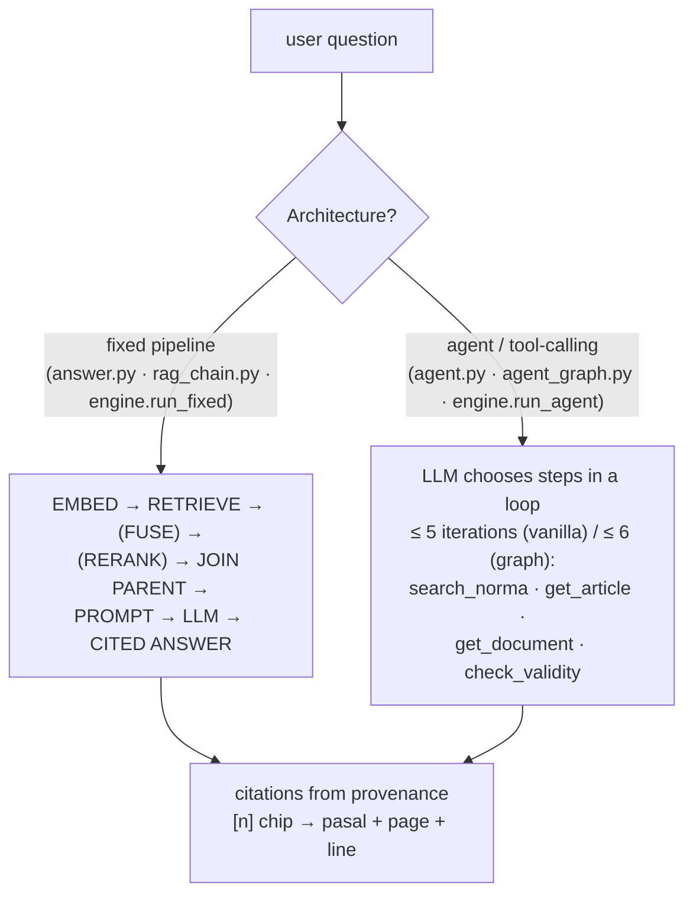

# Chatbot Strategies — How a Question Becomes a Cited Answer

> Code lives in three mirrored stacks: `rag-vanilla/` (pure Python — the
> reference implementation), `rag-langchain/` (LCEL + LangGraph), and
> `webapp/backend/engine.py` (the production engine behind the UI).
> All three execute the *same* strategies documented here.

## Two execution architectures



| | Fixed pipeline | Agent (tool-calling) |
|---|---|---|
| When the steps are | predictable ("find article X") | unpredictable ("is this law still valid *and* who holds sovereignty?") |
| LLM calls | 1 | 1 per iteration (≤ 5–6 total) |
| Determinism | full | LLM decides the path |
| Entry | `answer.py` / `run_fixed` | `agent.py` / `run_agent` |

## Strategy map (one document each)

| # | Strategy | What it decides | Doc |
|---|---|---|---|
| 01 | **Query pipeline** | end-to-end fixed flow, prompt anatomy, small-to-big join | [01-query-pipeline.md](01-query-pipeline.md) |
| 02 | **Retrieval** | dense exact / HNSW / IVF · BM25 · hybrid RRF · filters | [02-retrieval-strategies.md](02-retrieval-strategies.md) |
| 03 | **Rerank** | 2-phase cross-encoder (Qwen3-Reranker-0.6B) | [03-rerank-strategy.md](03-rerank-strategy.md) |
| 04 | **Agent & tools** | 4 narrow tools, validated dispatcher, iteration caps | [04-agent-tool-calling.md](04-agent-tool-calling.md) |
| 05 | **Validity & safety** | never invent legal status · out-of-corpus honesty · key redaction | [05-validity-safety.md](05-validity-safety.md) |

## Defaults that every strategy shares

| Constant | Value | Where |
|---|---|---|
| `TOP_K` | 8 (recall@8 measured = 0.75) | `rag-vanilla/config.py` |
| Rerank pool | 12 candidates → top-k | `config.RERANK_POOL_SIZE` |
| Hybrid per path | 12, fused by RRF `K=60` | `config.HYBRID_PER_JALUR`, `RRF_K` |
| Context budget | 12,000 chars | `config.CONTEXT_CHAR_BUDGET` |
| BM25 | Okapi k1=1.2, b=0.75 | `bm25.py` |
| Guardrail | only `part == "norma"` enters context | embeddings hold norma only |
| Styles | `ringkas` / `standar` / `rinci` | prompt style instructions |

## Try it without any API key

```powershell
cd rag-vanilla
..\.venv\Scripts\python.exe answer.py -q "Who holds sovereignty under the 1945 Constitution?" --dry-run --show-context
..\.venv\Scripts\python.exe agent.py  -q "who holds sovereignty" --dry-run
```

`--dry-run` runs **real retrieval** and fakes only the LLM call — you see the
exact prompt, the candidates, the scores and the citation numbers.
