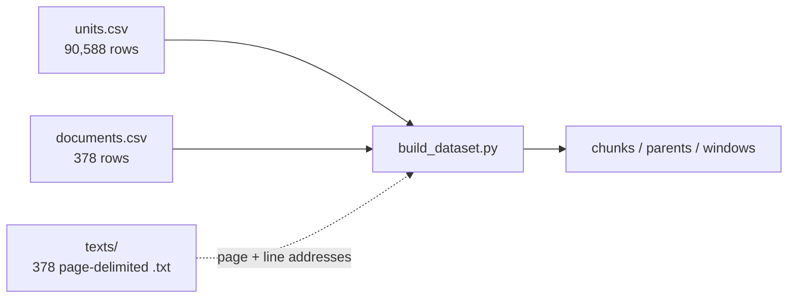

# Stage 01 — Source Corpus

> Input of the whole pipeline: the untouched Mendeley v1 corpus in
> `data/corpus/`. Integrity pinned by `checksums.md5`.

## Strategy

The corpus is treated as **read-only evidence**. Nothing in `pipeline/` ever
edits it; the build only *reads* and *points back* to it.



### Provenance contract (the dataset's biggest edge)

Every norm unit resolves to an exact location:

```
(document, page_number, line_start, line_end)  →  texts/<folder>/<file>.txt
```

Page boundaries inside each text file are explicit (`=== PAGE n ===`); every
non-empty line has a stable ordinal. This is what lets the final chatbot cite
*"Pasal 1 UUD 1945, page 3, lines 12–14"* and lets the QA gate verify it
automatically (Stage 06).

## The three files

### `units.csv` — 90,588 rows, one norm unit each

| Column group | Fields |
|---|---|
| Identity | `unit_id`, `document_name`, `relative_path`, `doc_type`, `hierarchy_level`, `year` |
| Address | `page_number`, `line_start`, `line_end` |
| Structure | `unit_type` (`body` / `heading_bab` / `heading_paragraf` / `heading_pasal`), `bab_marker`, `paragraf_marker`, `pasal_marker`, `ayat_marker` |
| Text | `text_original`, `text_normalized` |
| Quality audit (IndoBERT) | `indobert_token_count`, `indobert_unk_count`, `indobert_unk_ratio`, `quality_flag` |

### `documents.csv` — 378 regulations

Identity is read from each document's **title block**, not the file name
(`filename_title_mismatch` flags disagreements). Includes the two-axis
legal-force classification:

- **I-ladder** — position under Article 7(1) of Law 12/2011 (UUD → TAP MPR → UU → PP → Perpres → Permen → perlembagaan)
- **II-delegated** — binding force delegated under Article 8

### `texts/` — 378 plain-text files, grouped like the source archive

| Folder | Kind | Example |
|---|---|---|
| `01-UUD` | Constitution + amendments | `UUD 1945.txt` |
| `02-TAPMPR` | MPR decrees | `TAP_MPR_7_1978.txt` |
| `03-UU` | Laws | `UU-NO-7-TAHUN_2017.txt` |
| `04-PERPPU` | Government-in-lieu regulations | |
| `05-PP` | Government regulations | |
| `06-PERPRES` | Presidential regulations | |
| `07-PERMEN` | Ministerial regulations | |
| `08-PERLEMBAGA` | Institutional rules (KPU, Bawaslu, DKPP, MA, …) | majority of the corpus |

## Real output

- 378 regulations, 1945–2024
- 90,588 norm units with page+line addresses — **0 rows lost** by design
- Source PDFs are *not* redistributed (JDIH originals); `documents.csv`
  records enough identity to re-extract from the originals

## Why not OCR/PDF directly at query time?

Parsing PDFs per query would be slow, non-deterministic and destroy stable
addresses. Pre-segmented units + page/line provenance make retrieval
answers **auditable back to the official text**.

Next: [02 — Chunking](02-chunking.md)
