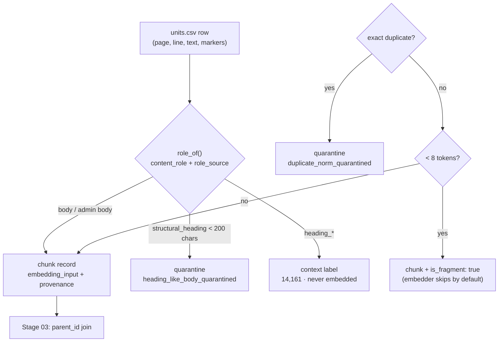

# Stage 02 — Chunking (structure-based segmentation)

> Code: `pipeline/build_dataset.py` · Output: `result/chunks.jsonl` (74,218) +
> `result/quarantine.jsonl` (2,209)

## Strategy — 10 design decisions that shape the chunks

1. **Structure-based, not token-based.** A chunk boundary is a *legal*
   boundary (article / verse), never a token slice. 1 row of `units.csv` =
   1 chunk. IDs and provenance are never mutated by processing.
2. **No auto-merge between units.** Two short verses stay two chunks —
   merging would break the page+line address.
3. **Carry-forward only `bab` + `pasal`** from heading units, streaming per
   document ordered `page → line → unit_id`. **Verses are never carried
   forward and never invented**; `citation.ayat = null` means a
   single-norm article (valid per UU 12/2011 appendix & Akoma Ntoso).
4. **Headings are labels, not content.** 14,161 heading units become context
   markers (`heading_bab`, `heading_paragraf`, `heading_pasal`) and are
   **never embedded**.
5. **Granular `content_role`** replaces a binary norma/admin flag:
   `norma`, `pertimbangan`, `dasar_hukum`, `preamble`, `administratif`,
   `ketentuan_peralihan`, `ketentuan_penutup`, `penjelasan` — each with an
   audit field `role_source` (marker | flag+artifact | flag+keyword |
   keyword | default). Legacy `part` (`norma`|`administratif`) kept as a
   compatibility alias.
6. **Self-contained vectors.** Every embeddable text is prefixed:
   `embedding_input = official_title — citation: body`, so a vector never
   floats free of its regulation identity.
7. **Short fragments are kept**, flagged `is_fragment: true` (< 8 tokens /
   `needs_review_short`) — the embedder skips them by default, so the index
   is clean while **zero corpus rows are lost**.
8. **Reasoned quarantine, never silent drops.** Every discarded row carries a
   machine-checkable reason.
9. **Deterministic.** Fixed seed `20260907`, fixed sorts — rerunning the
   build reproduces byte-identical outputs.
10. **Fail-fast schema validation** of both CSVs + SHA256 of sources recorded
    in the manifest.



## Real output — funnel & role distribution

From `manifest.json`:

| Metric | Value |
|---|---|
| Input rows | 90,588 |
| **Chunks** | **74,218** |
| — `part = norma` | 66,292 |
| — `part = administratif` | 7,926 |
| — flagged fragments | 4,704 (kept, skipped at embed time) |
| `content_role` distribution | `norma` 66,292 · `administratif` 7,694 · `pertimbangan` 55 · `preamble` 141 · `penjelasan` 24 · `dasar_hukum` 12 |
| Headings as context | 14,161 (never embedded) |
| Quarantine | 2,209 = 587 `duplicate_norm_quarantined` + 1,622 `heading_like_body_quarantined` |

## A real chunk record (truncated)

`chunks.jsonl` — the sovereignty verse of Article 1 of the 1945 Constitution
(`uud-1945::p::1::02`), copied from the actual build output:

```json
{
  "chunk_id": "uud-1945::p::1::02",
  "parent_id": "uud-1945::p::1",
  "document_id": "uud-1945",
  "official_title": "UUD",
  "citation": { "bab": "BAB I", "paragraf": null, "pasal": "Pasal 1", "ayat": "2" },
  "citation_str": "Bab I Pasal 1 Ayat (2)",
  "content_role": "norma",
  "role_source": "marker",
  "part": "norma",
  "is_fragment": false,
  "doc_type": "UUD",
  "doc_type_full": "Undang-Undang Dasar Negara Republik Indonesia Tahun 1945",
  "legal_force_axis": "I-ladder",
  "hierarchy_level": 1,
  "year": 1945,
  "legal_status": null,
  "text": "(2) Kedaulatan adalah di tangan rakyat, dan dilakukan sepenuhnya oleh Majelis Permusyawaratan Rakyat.",
  "embedding_input": "UUD - Bab I Pasal 1 Ayat (2): (2) Kedaulatan adalah di tangan rakyat, dan dilakukan sepenuhnya oleh Majelis Permusyawaratan Rakyat.",
  "provenance": {
    "source_unit_id": 400669,
    "texts_path": "texts/01-UUD/UUD 1945.txt",
    "page_number": 1, "line_start": 31, "line_end": 32
  },
  "char_len": 101,
  "token_estimate": 17,
  "quality_flags": ["ok"]
}
```

Note the self-contained `embedding_input`: title + citation prefix means the
vector itself already knows *"which regulation, which article"* — the LLM and
the reranker never see a floating anonymous sentence.

ID grammar (memorize this — it appears everywhere downstream):

```
uud-1945                    document
 └── uud-1945::p::1         parent   (whole article)
      ├── uud-1945::p::1::02   chunk  (one verse)
      └── uud-1945::p::1::w01  window (only if parent > ~1,800 chars)
```

Next: [03 — Parents & Windows](03-parents-windows.md)
