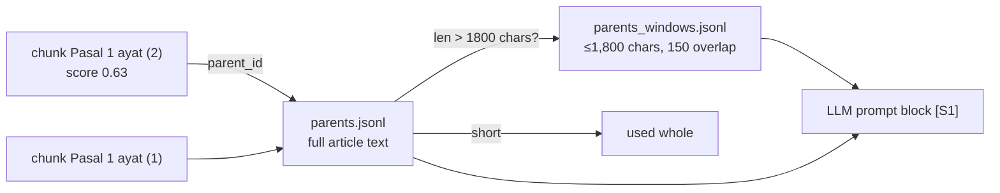

# Stage 03 — Parents & Windows (small-to-big context)

> Code: `pipeline/build_dataset.py` · Outputs: `result/parents.jsonl` (11,413)
> + `result/parents_windows.jsonl` (14,689)

## Strategy — why not just send the chunk to the LLM?

A single verse is *sharp for search* but often *too thin to answer from* —
legal meaning usually lives in the whole article (all ayat + headings).
So the build separates two jobs:

| Layer | File | Job |
|---|---|---|
| **Child** (chunk) | `chunks.jsonl` | what the retriever matches against (precise) |
| **Parent** | `parents.jsonl` | whole article/admin block — what the LLM reads (complete) |
| **Window** | `parents_windows.jsonl` | deterministic slices of *long* parents so context always fits an LLM token budget |

This is **parent-document retrieval** ("small-to-big"): search small, answer big.



## Parent ID — global & stable

```
{document_id}::p::{pasal}     e.g.  uud-1945::p::1          (article parent)
{document_id}::adm::{nn}      e.g.  uud-1945::adm::001      (non-article admin block)
window_id = {parent_id}::w{nn} e.g. uud-1945::p::1::w01
```

Unique corpus-wide → safe as a vector-DB payload field in any store.

## Window rules (deterministic)

- Hard cap **1,800 chars** per window
- **150-char overlap** between consecutive windows (no clause lost at a cut)
- Only parents longer than the cap are windowed (**1,632** of 11,413)
- Cut points are computed from the parent text itself — same input ⇒ same
  windows, always

## Real output

| File | Rows | Content |
|---|---|---|
| `parents.jsonl` | **11,413** | full article/admin text + `window_ids` list |
| `parents_windows.jsonl` | **14,689** | ≤1,800-char slices (1,632 long parents) |

## How the answer layer uses it

`rag-vanilla/dataset.py → context_for_parent()` turns *"vector row 17,482"*
into *"Article 1, page 1"*: retrieve on child → join `parent_id` → inject the
parent text (or its windows) into the prompt → cite `citation_str` +
`official_title` + provenance page. See
[chatbot/01 — query pipeline](../chatbot/01-query-pipeline.md).

Next: [04 — Embedding](04-embedding.md)
