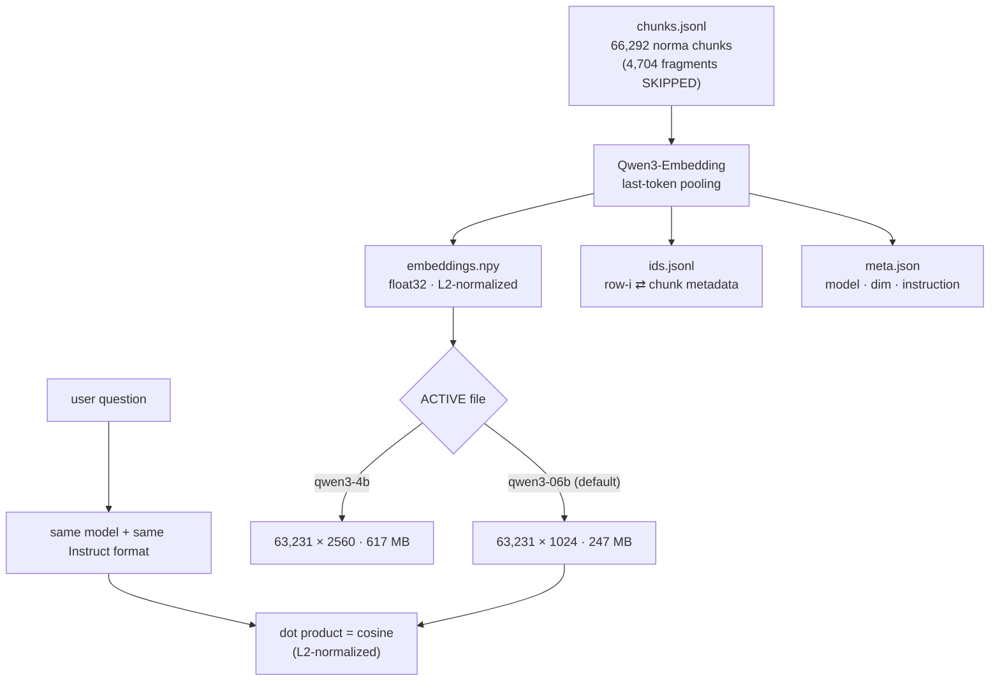

# Stage 04 — Embedding

> Code: `pipeline/embed_example.py` (corpus) · `pipeline/embed_query_qwen.py`
> & `rag-vanilla/embedder.py` (query) · Output: `result/embeddings/`

## Strategy

Text → dense vector so that *"kedaulatan"* lands near *"sovereignty"* even
with different wording. This project runs **two parallel embedding models**,
each in its own folder, switched by a one-line `ACTIVE` file.



## Iron rule (break it and search collapses)

> **model index = model query.** Switching models means re-embedding *both*
> sides. The query must use the exact same instruction template, padding,
> pooling and normalization as the corpus:

```
Instruct: Given a user question about Indonesian legislation, retrieve the
most relevant legal provisions (norma) that answer the question
Query: <user question>
```

Recorded in `meta.json.query_instruction`; locked inside one function
(`embed_query()`), with left padding + last-token pooling + L2 normalize.
Also recorded: `part_filter: "norma"`, `fragments_included: false`,
`text_field: "embedding_input"`.

## Real output — from `embeddings/*/meta.json`

| | `qwen3-06b` (ACTIVE default) | `qwen3-4b` |
|---|---|---|
| Model | `Qwen/Qwen3-Embedding-0.6B` | `Qwen/Qwen3-Embedding-4B` |
| Dim | **1024** | **2560** |
| Vectors | **63,231** | 63,231 |
| Pooling | last-token | last-token |
| Max length | 1,024 tokens | 1,024 tokens |
| Normalization | L2 | L2 |
| Matrix size | ~247 MB float32 | ~617 MB float32 |
| Build time (recorded in meta.json) | 1,346.9 s | 380.6 s |

Why **63,231 < 74,218 chunks**: only `part == "norma"` is embedded, and
fragments are skipped — the searchable index is clean by design; everything
else stays reachable through parents/joins.

## Why no vector DB is required at this scale

63,231 × 1024 floats = 247 MB, memory-mapped (`mmap_mode="r"`). One NumPy
matrix–vector multiply scores **all** vectors in well under a second on CPU —
that is the `ExactRetriever` baseline (see
[chatbot/02 — retrieval strategies](../chatbot/02-retrieval-strategies.md)).
Milvus (HNSW) is available for millions of vectors, not needed here.

## Regenerate

```powershell
cd pipeline
python embed_example.py                                    # 0.6B, norma only
python embed_example.py --model Qwen/Qwen3-Embedding-4B    # the other model
```

Model weights load from the local HuggingFace cache (`local_files_only=True`)
— the whole retrieval stack works **offline** once cached.

Next: [05 — Storage & Indexes](05-storage-indexes.md)
