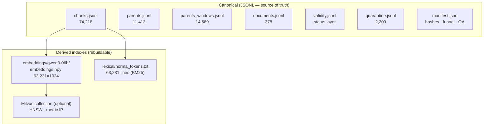

# Stage 05 — Storage & Indexes

> Outputs: `pipeline/result/` (7 JSONL/JSON files) + `embeddings/` + `lexical/`
> Optional server: Milvus (Docker)

## Strategy — layered storage, every layer auditable

Nothing is hidden inside a black-box database. The **canonical store is plain
JSONL** (git-diffable, greppable, stdlib-readable); vector/lexical indexes are
*derived* artifacts that can be rebuilt from it.

## The 7 canonical files

| File | Rows | Role in the chatbot |
|---|---|---|
| `chunks.jsonl` | 74,218 | embed-ready records + provenance |
| `parents.jsonl` | 11,413 | full article text injected into the prompt |
| `parents_windows.jsonl` | 14,689 | token-bounded slices of long parents |
| `documents.jsonl` | 378 | regulation metadata + `legal_status` columns |
| `validity.jsonl` | 378 | validity layer (default `pending_enrichment`) |
| `quarantine.jsonl` | 2,209 | every discard + measured reason |
| `manifest.json` | — | SHA256 of sources, funnel, policies, QA gate |

## Lexical index (BM25) — `lexical/norma_tokens.txt`

- Built once: `python bm25.py --build` → **63,231 lines**, strictly aligned
  with `embeddings/ids.jsonl` (line *i* ⇄ vector *i*)
- Okapi BM25, **k1 = 1.2, b = 0.75**, over article tokens + citation + title
- Strong on exact identifiers: *pasal numbers, years, doc types* — where
  dense vectors are weakest
- Missing file → safe automatic fallback to dense-only

## Vector index — three options, same data

| Type | Where | Params | Role here |
|---|---|---|---|
| **Exact (NumPy)** | `ExactRetriever` | none | default · ground-truth baseline · <50 ms at 63k |
| **HNSW** | Milvus (`insert_milvus.py`) | `M=16`, `efConstruction=200`, search `ef=64` | production ANN; verified identical order to exact on golden queries |
| **IVF_FLAT** | Milvus | `nlist≈512`, `nprobe` | only pays off at millions of vectors |
| **FLAT** | Milvus | none | exact inside the server |

Metric is **IP (inner product)** everywhere — vectors are L2-normalized, so
dot = cosine. Changing index type never touches schema, insert, `ids.jsonl`
or the query encoder; only `index_params` (at collection creation) and search
`params` (`ef` / `nprobe`) change. Full comparison:
[`docs/retrieval-indexes.md`](../../docs/retrieval-indexes.md).

## Trap already hit (do not repeat)

Milvus builds HNSW **asynchronously** — a query right after insert/flush can
return a *different* (worse) chunk. Always run `smoke_milvus.py` before
trusting results. See the runbook:
[`docs/operations-runbook.md`](../../docs/operations-runbook.md).

Next: [06 — QA & Evaluation](06-qa-eval.md)
