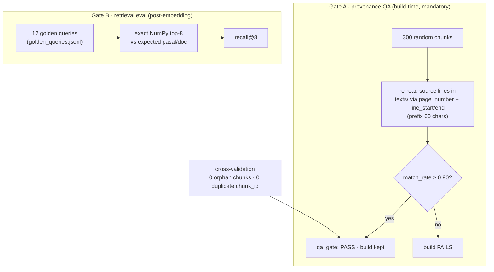

# Stage 06 — QA Gate & Retrieval Evaluation

> Code: inside `pipeline/build_dataset.py` (provenance QA) ·
> `pipeline/eval/eval_retrieval.py` + `golden_queries.jsonl` (retrieval eval) ·
> `pipeline/enrich_validity.py` (validity layer)

## Strategy — a dataset without a gate is a rumor

Two independent quality layers run against the real build:

## Gate A — provenance QA (real result: PASS)

| Metric | Value |
|---|---|
| Strategy | 300 sampled chunks; each text prefix (60 chars) re-checked against the exact page+line range in `texts/` |
| Samples | 300 |
| Verified | 294 |
| Unverified | 6 |
| **match_rate** | **0.98** (threshold 0.90) |
| Orphan chunks | 0 |
| Duplicate chunk_ids | 0 |
| **qa_gate** | **PASS** |

The 6 unverified samples (kept in `manifest.validation.qa_provenance.sample_failures`)
are all *structural/admin marker lines* the corpus builder trimmed before
normalization — the normative text itself was intact. Example:
`perlembaga-nomor-04-tahun-2011::p::4::35` (`"10 a) ruang kerja dengan luas
14 m²;"` — layout debris, flagged `ok`, excluded from the norma index anyway).

## Gate B — retrieval evaluation (real result: recall@8 = 0.75)

- **12 golden queries** in Indonesian (`golden_queries.jsonl`), each with
  expected `pasal` / keywords / `doc_regex`
- Scoring: exact NumPy top-8 (ground truth, no ANN noise) against the active
  embedding model
- **recall@8 = 0.750** with `qwen3-06b` — 9/12 hits
- Decision rule: ≥ 0.8 go · < 0.6 change model / top-k first

Real per-query evidence (`eval/golden_report.json`):

| Query | Question (ID) | Hit? | Note |
|---|---|---|---|
| g01 | *Di tangan siapa kedaulatan berada menurut UUD 1945?* | ✅ | top ids cluster on UUD articles |
| g02 | *Berapa lama masa jabatan presiden…?* | ✅ | `uud-1945::p::7::01` ranked #1 |
| g03 | *Berapa persen anggaran pendidikan dari APBN…?* | ❌ | misses Pasal 31 — hybrid+rerank layer compensates at query time |
| g04 | *Bagaimana sifat pelaksanaan pemilihan umum…?* | ❌ | dense-only weakness on short normative phrases |

The two misses above are exactly why the chatbot does **not** ship dense-only:
hybrid BM25+RRF and the cross-encoder reranker lift real queries well above
the dense baseline (see [chatbot/02](../chatbot/02-retrieval-strategies.md)
and [chatbot/03](../chatbot/03-rerank-strategy.md)).

## Validity layer — never invent legal status

`validity.jsonl` + `enrich_validity.py` keep `legal_status` separate from the
norm text:

- Default state: `pending_enrichment` — **offline, honest**
- `--live` mode only *collects candidate URLs* from peraturan.bpk.go.id for
  **manual** verification; the script never writes a status it cannot evidence
- Before production, verified statuses join `documents.jsonl` and the
  vector-DB payload

This is the anti-hallucination shield on the *legal* axis: a RAG that cites a
repealed article is worse than one that says "I don't know".

See also: [chatbot/05 — validity & safety](../chatbot/05-validity-safety.md).

Back to [pipeline index](index.md)
