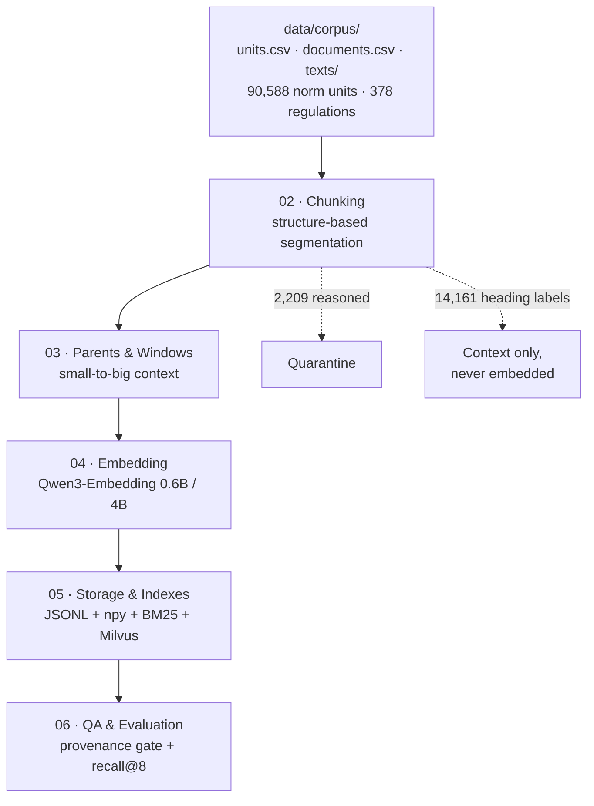

# Dataset Pipeline — Stage-by-Stage Documentation

> Canonical build **v4.1** (`pipeline/build_dataset.py`). Every number on this
> page comes from `pipeline/result/manifest.json` (the single source of truth).
> Source corpus: Mendeley Data DOI `10.17632/8wpjvhh7g2.1`, **CC BY 4.0** —
> credit *Qausar, Prabowo, Arifin & Isa (Binus University)*.

## The pipeline at a glance



## Funnel — real numbers from this build

| Stage | Output | Count |
|---|---|---|
| Input | norm units (`units.csv`) | **90,588** |
| Documents | regulations (`documents.csv`) | **378** (1945–2024) |
| Chunking | embed-ready chunks | **74,218** (66,292 `norma` · 4,704 fragments) |
| Quarantine | reasoned discards | **2,209** (587 duplicates · 1,622 heading-like) |
| Parents | whole articles / admin blocks | **11,413** (1,632 long → windowed) |
| Windows | ≤1,800-char slices (150 overlap) | **14,689** |
| Embedding | vectors × 2 models | **63,231** × 1024-d (0.6B) · × 2560-d (4B) |
| QA gate | provenance match (300 samples) | **98% — PASS** · 0 orphans · 0 duplicate IDs |
| Eval | recall@8 on 12 golden queries | **0.75** |

Accountability check (no silent loss):
`74,218 chunks + 2,209 quarantine + 14,161 headings = 90,588` ✔

## Stage documents

| # | Document | Strategy focus | Real output |
|---|---|---|---|
| 01 | [Source Corpus](01-source-corpus.md) | units / documents / texts + provenance contract | 378 files, page+line addressing |
| 02 | [Chunking](02-chunking.md) | structure-based chunks, `content_role`, fragments, quarantine | 74,218 chunks.jsonl |
| 03 | [Parents & Windows](03-parents-windows.md) | parent–child (small-to-big), deterministic windows | 11,413 parents · 14,689 windows |
| 04 | [Embedding](04-embedding.md) | Qwen3 last-token pooling, instruction format, iron rule | 63,231 × 1024-d npy |
| 05 | [Storage & Indexes](05-storage-indexes.md) | JSONL layout, BM25 lexical index, Milvus HNSW/IVF/FLAT | 7 result files + npy |
| 06 | [QA & Evaluation](06-qa-eval.md) | 300-sample provenance gate, golden-query recall, validity layer | 98% PASS · recall@8 0.75 |

## Regenerate everything (deterministic)

```powershell
cd pipeline
python build_dataset.py        # chunks/parents/windows/manifest — stdlib only, <1 min
python embed_example.py        # embeddings (needs torch + transformers; GPU recommended)
python eval/eval_retrieval.py  # recall@8 report
```

Build config (from `manifest.json`): seed `20260907`, window ≤1,800 chars /
overlap 150, heading-like ≤200 chars, fragment <8 tokens, **no auto-merge
between units**.
